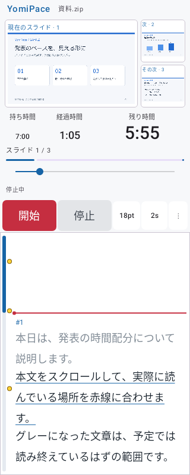
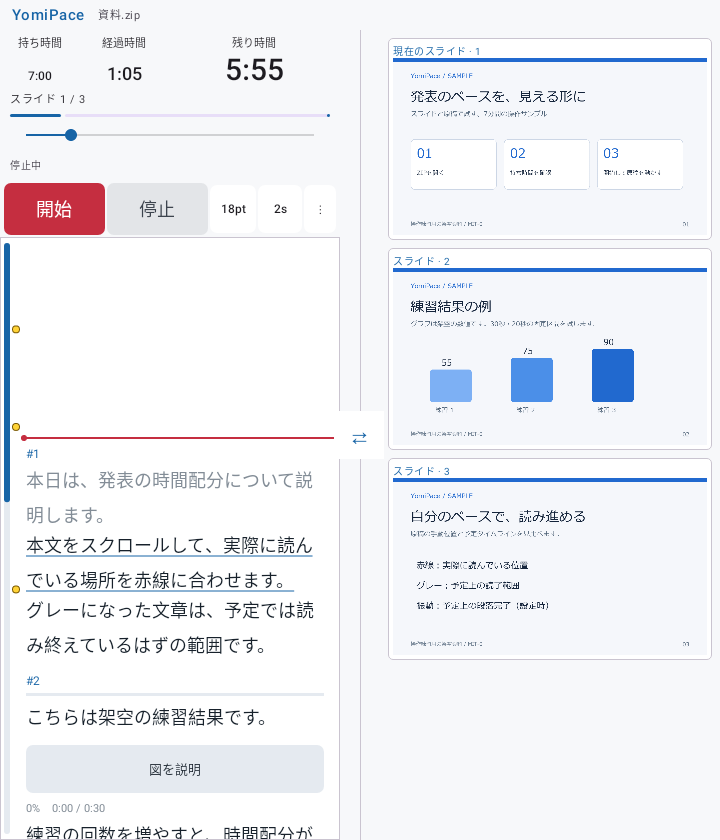
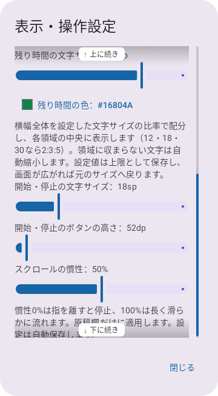

# YomiPace

**0.5.5**：DOPAGAKIモードが自然な時間経過で強くならず、シーク時だけ更新される不具合を修正。実際の画面で開始して時計を進め、シーク・再開・カーブ変更・画面の停止復帰・予定時間での最大値を検証しました。[再現と修正確認](docs/0.5.5_自然再生と演出更新の検証.md)を参照してください。

**0.5.4**：DOPAGAKIモードに指の位置で弾ける火花・クラッカー・風船・打ち上げ花火を追加。標準カーブは直線で、全て予定時間に設定した強さへ到達します。下側の両端の猫がビートで跳ね、終盤は目からビーム。原稿の文字・時計・進捗バーの読みやすさを保ちます。[変更と検証](docs/0.5.4_DOPAGAKIパーティ演出の検証.md)を参照してください。

**0.5.3**：名称を「DOPAGAKIモード」に統一。招き猫を見える位置へ戻し、キリ番・工事中・相互リンク・WebRing・足あとBBSなど個人ホームページ風の演出を追加。「演出のシェード」0～100%で色の暗さを調整できます。初期0%は原色くっきり。序盤から終盤への段階演出、巻き戻し、原稿・時計・進捗バーの読みやすさは維持します。[変更と検証](docs/0.5.3_DOPAGAKIとシェードの検証.md) を参照してください。

**0.5.2**：ドパガキ演出を控えめな序盤から徐々に強める構成へ。強さと盛り上がる速さを設定でき、巻き戻しで強さも戻ります。専用の振動ビートは4拍ごとに強拍。進捗バーを保護し、スライド上の装飾は薄くしました。原稿の前景表示は維持します。[変更と検証](docs/0.5.2_段階演出と振動ビートの検証.md) を参照してください。

**0.5.1**：ドパガキモードを大幅増量。開始直後から連続花火・原色の渦・稲妻に加え、虹色WELCOME・電光テロップ・数字カウンター・招き猫で古き良きインターネットを召喚します。原稿は背景を動かし、文字・進捗・赤線を最前面へ描画。時計を保護し、スライド番号を大きく表示します。通常モード・設定・原稿位置は保持します。[変更と検証](docs/0.5.1_ドパガキ増量と原稿前景の検証.md) を参照してください。

**0.5.0**：「実験」→「ドパガキモード」で無音の火花・コンボ・終盤の集中線と紙吹雪を楽しめます。原稿と時計を描画から保護します。時計下の進捗とシークは直接操作できる1本へ統合しました。バイブはこの版への初回更新時も一度ON・中へ設定し、以降のOFF選択は保持します。[今回の変更と検証](docs/0.5.0_実験モードと進捗バーの検証.md) を参照してください。

**0.4.8**：バイブの未設定時の初期値を「ON・中」にし、黄色いスライド開始点を原稿スクロールバーの内側に表示します。保存済みのバイブ設定は引き継ぎます。

**0.4.7**：新規インストール後の初回起動で、使い方を説明する10枚・5分のサンプルを自動で開きます。最終スライドでアーカイブからの削除方法を案内します。既存版からの更新では現在の資料を保持し、サンプルは追加しません。手動取り込み用の [はじめてガイドZIP](samples/YomiPace-welcome.zip) と [内容・再生成方法](samples/welcome/README.md) もあります。

発表の「予定ペース」と「実際に読んでいる位置」を見比べる、Android用の発表練習・読み上げ支援アプリです。スライド画像と原稿をまとめたZIPを読み込み、ネット接続なしで利用できます。

[APKをダウンロード](https://github.com/UroCo-lab/YomiPace/releases/latest) · [サンプルZIP](samples/YomiPace-sample.zip) · [詳しい操作説明](docs/操作説明.md)

## 主な機能

- 持ち時間・本文の文字数・固定の説明区間から予定ペースを計算。予定上読み終わった文をグレーで表示します。
- 原稿を手動スクロールし、実際に読んでいる箇所を固定の赤線に合わせます。表示スライドはこの位置に追従します。
- `[図を説明(00:30)]` などの固定区間を時間バーで表示します。
- 段落全体が予定上グレーになった時点で振動できます（初期設定はON・中）。
- 経過時間のシーク、原稿編集、アーカイブ・ゴミ箱、文字・ボタンのサイズと慣性の調整に対応します。
- 原稿スクロールバーは右・左・なしを選択でき、設定を保存します。
- 設定画面は常時表示のスクロールバーと上下の影・案内で、続きの方向と現在位置が分かります。バーのドラッグ・タップでも移動できます。
- 持ち時間・経過時間・残り時間を横スクロールなしの横一列に表示します。横幅全体を設定フォントサイズの比率で配分し、各領域の中央に表示します。文字が収まらない場合は自動縮小します。各色と、計測中のスリープ禁止（初期ON）も保存できます。
- スマートフォン・タブレット・折りたたみ端末に対応。Foldのメイン画面は端末から折りたたみ情報を取得でき、幅600dp以上なら縦向きでも2列を維持します。

音声認識や自動スクロールはありません。グレー表示は予定を示し、実際に読み終わったことを検出しません。

## 画面例

公開用の架空サンプルを読み込んだ自動UIテストの画像です。実機撮影ではありません。

| スマートフォンの縦画面 | Fold相当の縦画面（2列） |
|---|---|
|  |  |

0.4.6の設定画面では、スクロール位置と上下の続きが常時分かります。



## インストール

対応環境は **Android 8.0（API 26）以降**。現行の配布版は **[0.5.5](https://github.com/UroCo-lab/YomiPace/releases/tag/v0.5.5)** です。

0.4.7では初回起動のはじめてガイドを追加しました。新規インストールではZIPの準備なしで試せます。最終スライドの手順で削除でき、再起動しても自動で戻りません。

0.4.6では、設定画面に常時表示のスクロールバーと、上下の影・続きの案内を追加しました。バーのドラッグ・タップで移動でき、「閉じる」ボタンは画面内に固定します。

0.4.1から、原稿スクロールバーの右・左・なし、残り時間の大きな表示、時計ごとの色と文字サイズ、計測中のスリープ禁止を追加しました。時計3項目は、設定フォントサイズの比率で横幅全体を配分し、各領域の中央へ表示します。

1. [GitHub Releases](https://github.com/UroCo-lab/YomiPace/releases/latest) を開き、対象バージョンの `YomiPace-<version>-release.apk` を端末に保存します。
2. APKを開き、Androidの案内に従ってインストールします。必要に応じて、使用しているブラウザーやファイルアプリからのインストールを許可します。
3. 必要なら同じページの `SHA256SUMS.txt` と照合します。配布APKは専用の非公開鍵で署名しています。

GitHubで配布する0.4.8は、0.4.7以前と同じ署名鍵です。旧公開版が入っている端末では、0.4.8のAPKを開いて上書き更新できます。実機での更新操作は未検証です。

**以前のローカル配布デバッグ版から切り替える場合**：署名が異なるため上書きできません。転送元の資料ZIPと編集した原稿の控えを確保してから旧版をアンインストールし、配布版をインストールしてください。アンインストールでアプリ内のアーカイブ・編集原稿・設定が消えます。アプリ内で編集した原稿は編集画面からテキストをコピーして控えてください。今後の公式配布版は同じ配布鍵を使い、上書き更新を行う予定です。

## 使い方

0.4.7の新規インストールでは「YomiPace はじめてガイド（10枚）」が停止状態で開きます。持ち時間は5分で、「開始」と原稿の手動スクロールを試せます。不要なら「停止」→「⋮」→「アーカイブ」でこのガイドのゴミ箱ボタンを押します。完全削除は「ゴミ箱」から確認して実行します。「クリア」では表示だけ解除し、削除やクリアのあとに自動再表示しません。

1. [サンプルZIP](samples/YomiPace-sample.zip) をダウンロードし、アプリの「⋮」→「ZIPを開く」で選びます。GitHubのファイル表示では「Download raw file」から保存できます。Releasesにも同じZIPを添付します。
2. 持ち時間（サンプルは7分）を確認し、「開始」を押します。「停止」で一時停止します。
3. 原稿を指で動かし、読んでいる箇所を赤線に合わせます。予定のグレー境界と比較してペースを調整します。
4. 図の説明区間は時間バーを参考にします。段落完了の振動は初期ON・中です。「グレー表示のバイブ」で変更できます。
5. シークバーを触ると時計が停止し、指定時刻へ移動します。「開始」で再開します。シークで手動の原稿位置は動きません。

「クリア」は表示解除です。取り込んだ資料はアーカイブに残り、ゴミ箱から確認して完全削除できます。原稿編集・表示設定などは[操作説明](docs/操作説明.md)を参照してください。PPTXやPDFを直接開く機能はありません。

## ZIP・script.txtの仕様

ZIP直下、または1段だけの共通親フォルダーに、画像と原稿をまとめます。

```text
presentation.zip
├── 001.png
├── 002.png
├── 003.png
└── script.txt
```

- 画像名は `001` から欠番のない3桁連番。PNG／JPG／JPEGに対応します。拡張子の大小は問いません。同じ番号の重複は不可です。16:9の画像を推奨します。
- `script.txt` はUTF-8（BOM可）、LF／CRLFに対応。画像の全枚数に対応する `#1`、`#2`…を順番に単独行で書きます。本文がないスライドにも見出しが必要です。
- `time(mm:ss)` は先頭に1回。秒は00〜59、全体は0より大きい時間にします。省略・不正な時間指定の場合はアプリで持ち時間を確定します。
- 固定区間は `[任意の表示名(mm:ss)]` を単独行に記載。半角の角括弧・丸括弧・コロンを使い、秒は00〜59（0秒可）。動画という表示名でも動画再生は行いません。
- 本文の空白以外のUnicode文字数を基に、持ち時間から固定区間とスライド切替時間（枚数−1回）を引いた時間を配分します。本文があるときは配分時間を0より大きくしてください。
- 上限：200枚、画像1枚24MiB・40メガピクセル、原稿2MiB、展開合計256MiB、ZIP内1000項目。パストラバーサル、暗号化・破損ZIP、未対応ファイル、複数資料の混在は使用できません。既知のmacOSメタデータは無視します。

```text
time(07:00)

#1
本日は、発表の時間配分について説明します。

#2
こちらは架空の練習結果です。
[図を説明(00:30)]
結果を補足します。
[補足の時間(00:20)]

#3
最後にまとめます。
```

サンプルの画像・原稿・グラフの数値はすべて操作練習用に作成した架空の内容です。実際の発表資料・患者情報は含みません。

## ビルド方法

JDK **21**、Android SDK Platform **36**、Build Tools **36.0.0** を用意します。Gradle **8.11.1**、Android Gradle Plugin **8.10.1**、Kotlin **2.1.20** を固定しています。Android Studioでリポジトリを開き、Gradle JDKとSDKの場所を設定できます。初回ビルドは公式リポジトリへの接続が必要です。

1. このリポジトリをcloneし、ルートに `local.properties` を作成します（例：`sdk.dir=C\:/Android/Sdk`）。このファイルはGit管理しません。
2. `JAVA_HOME` をJDK 21へ設定して、以下を実行します。

```powershell
./gradlew.bat :core:test :app:testDebugUnitTest :app:assembleDebug :app:lintDebug
```

macOS／Linuxでは `chmod +x gradlew` の後、`./gradlew` を使います。デバッグAPKは `app/build/outputs/apk/debug/app-debug.apk` に生成されます。開発用署名鍵は各開発環境が自動生成し、公開リポジトリには含めません。

配布用は自身の鍵を生成し、以下の環境変数を安全なローカル環境に設定してビルドします。パスワードをコマンドやソースに直接書き込まないでください。

| 環境変数 | 内容 |
|---|---|
| `YOMIPACE_KEYSTORE` | 非公開の署名鍵ファイルの絶対パス |
| `YOMIPACE_STORE_PASSWORD` | キーストアのパスワード |
| `YOMIPACE_KEY_ALIAS` | 鍵の別名 |
| `YOMIPACE_KEY_PASSWORD` | 鍵のパスワード |

```powershell
./gradlew.bat :core:test :app:testDebugUnitTest :app:lintRelease :app:assembleRelease
```

出力は `app/build/outputs/apk/release/app-release.apk` です。環境変数がない場合は未署名の `app-release-unsigned.apk` を生成します。自身の鍵で作ったAPKは公式配布版へ上書きできません。`apksigner verify --verbose --print-certs` で署名を確認してください。

`scripts/create_sample.py --font <日本語フォントのパス>` はPillowを使う任意のサンプル再生成スクリプトです。フォントファイルは同梱しません。通常のアプリビルドにPythonは不要です。`.github/workflows/build.yml` ではテスト・Lint・デバッグAPK生成を行い、配布鍵は使いません。

## ライセンスとプライバシー

自作のソースコード・文書・サンプル画像と原稿は **MIT-0（MIT No Attribution）** です。改造・再配布・商用利用を許可し、自作部分について著作権表示の保持を必須としません。保証はありません。条件の全文は [LICENSE](LICENSE) にあります。

外部ライブラリ・Gradle Wrapperなどは各ライセンスが適用されます。MIT-0によって外部の表示義務などがなくなることはありません。[THIRD_PARTY_NOTICES.md](THIRD_PARTY_NOTICES.md) と [licenses](licenses/) を参照してください。配布APKにも外部ライセンスを収録します。

マイク・ネット通信・外部API・アクセス解析は実装していません。資料は端末内のアプリ専用領域へ保存し、アプリ自身から外部へ送信しません。公開リポジトリに署名鍵・認証情報・実際の発表資料・ローカル作業記録は含めません。

現行ソースの検証は [0.4.8 バイブ初期値とバー内の点](docs/0.4.8_バイブ初期値とバー内の点の検証.md) を参照してください。Core17件・追加テストDebug/Release各3件成功。Debug全体は65件中64件成功、失敗1・エラー0・スキップ0、Release全体は65件中64件成功、失敗1・エラー0・スキップ0で、全体はPARTIALです。両Lintエラー0、署名APK・CRC・配置検査は成功しています。画像待機タイムアウトの根本原因が解消したとは扱っていません。実機の振動・更新・Fold開閉は未確認です。
