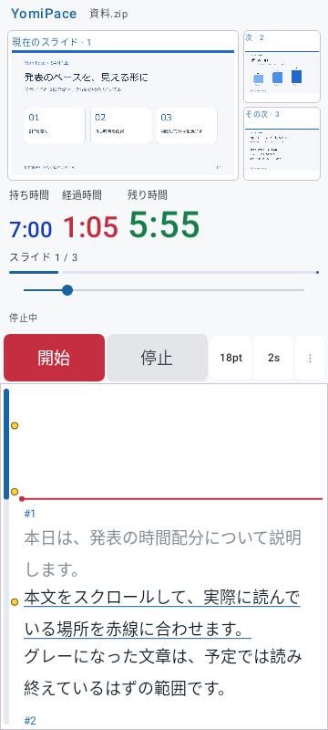

# 0.4.3 時計表示とスリープ設定

2026-11-02。versionCode 8。持ち時間・経過時間・残り時間を横一列に表示し、それぞれの文字サイズと色を保存できるようにしました。計測中のスリープ禁止の設定も追加しました（初期ON）。

## 操作と表示

「⋮」→「表示・操作設定」で変更します。

| 設定 | 動作 |
|---|---|
| 3時計の文字サイズ | それぞれ24～72sp、初期44sp。各欄の横幅は数字と見出しの実測幅に合わせて調整 |
| 3時計の色 | それぞれ自動・赤・青・緑・オレンジ・黒・白、または任意の#RRGGBB。初期は自動 |
| 計測中のスリープ禁止 | 初期ON。アプリを表示して計測中は自動消灯を防ぐ。OFF・停止・シークによる停止中は端末の通常設定に従う |

時計は文字の基準線を揃えて横一列を保ちます。幅が足りない場合は横スクロールでき、指定サイズを勝手に縮めたり縦並びへ変更したりしません。残り時間の正の値は秒未満を切り上げ、開始直後に1秒少なく見えることを避けています。超過時は残り時間を「−0:12」のように表示します。

指定色は超過時にも保ちます。自動色ではテーマの文字色を使い、超過時の経過時間と残り時間を注意色にします。小さい超過表示と全体進捗バーも維持します。色の入力には既存の文字・時間入力と同じAndroid標準ダイアログを使い、書式違反は保存せず入力欄に表示します。

計測中の設定変更でも時計と原稿位置を保持します。画面が短い場合の時計欄の縦スクロール、原稿スクロールバーの右・左・なし、Fold相当の2列配置と左右入替も保持しています。

## 追加検証

| テスト | 結果・対象 |
|---|---|
| `independentClockAppearanceAndSleepPreferenceSurviveRelaunch` | 3サイズ・3色・スリープ設定の保存と再起動相当の復元、未設定時ON、色の自動への復帰、不正な色文字列 |
| `threeClockFieldsStayOnOneRowAndWidthsFollowTheirFonts` | 異なるサイズで横一列・基準線一致、3色の適用、1項目だけのサイズ変更で他欄の幅が変わらないこと、最大サイズでの横スクロール、超過と巻き戻し後の残り時間 |
| `clockColorPickersAndSleepSwitchApplyWhileRunning` | メニューでの基本色／カラーコード入力、不正入力、残り文字サイズ、計測中のON／OFFと停止・シーク・再開時の実際のWindowフラグ |

色選択の試作ではComposeの編集欄を持つダイアログでUIアイドル待機が終わらない現象を検出しました。色入力をAndroid標準ダイアログへ変更し、画面を二重に重ねず切り替える実装にしました。上記のメニュー操作テストは最終実装で成功しています。

## 最終結果と限界

- Core全17件、Debug全42件：失敗0・エラー0・スキップ0。
- Release全42件の実行：41件成功、既存の `rotationKeepsClockAndLogicalPosition` が画像待機でタイムアウト。全件成功とは扱わずPARTIALとして記録。
- 最終ソースのRelease追加3件＋上記の画面回転1件の再実行：4件成功、失敗0・スキップ0。
- 署名付きReleaseビルド、Debug／Release Lint：成功。各エラー0・警告20件（依存更新13件・KTX書式5件・国際化2件）。
- APKのCRC、ライセンス収録、全4ABIのELF LOADの16KiB配置、署名、zipalignを確認。0.4.2の公開配布版と同じ署名証明書。

画像待機の断続的なタイムアウトは以前の版にも記録されています。今回根本原因を解消したとは扱いません。失敗ケースの削除やスキップで成功扱いにする変更は行っていません。

実機での消灯防止、端末のキーボード入力、実際のFold開閉、更新インストールはNOT_RUNです。Windowフラグの検証は自動テスト上の確認であり、実機で一定時間待った確認とは別です。GitHubへのpush・Release公開は行っていません。

## 表示例

公開用の架空サンプルを表示した自動UIテストのハードウェア描画画像です。実機撮影ではありません。



## 成果物

ローカルのrelease/に `YomiPace-0.4.3-release.apk`、公開用ソースの `YomiPace-0.4.3-source.zip`、`SHA256SUMS.txt` を保存します。ソースZIPは未コミットの機能変更を含む作業ツリーの書き出しです。旧版のAPK・ソースZIP・ハッシュと専用の非公開署名鍵を保持しています。

APKのSHA-256：

```text
dc918282d10fee0e5a07b68828503498eea203b7185d8326ca7f6fe77139d348
```
