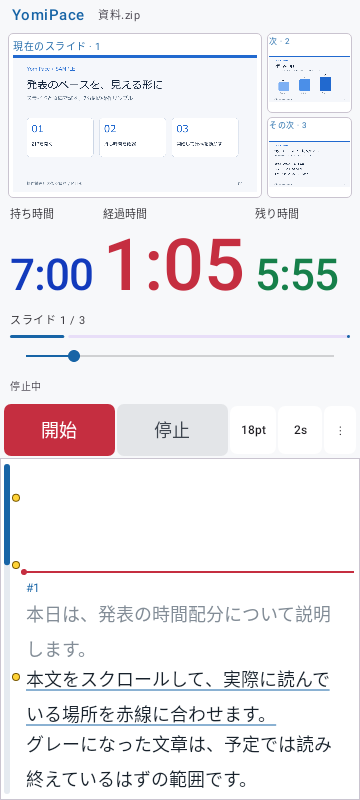

# 0.4.4 時計3項目の自動縮小

2026-11-02。versionCode 9。持ち時間・経過時間・残り時間の横スクロールを廃止しました。対象は時計の表示項目です。

## 動作

- 3項目を横スクロールなしで横一列に表示します。
- 1項目の文字サイズを大きくしたときは、その項目を優先して、他2項目の表示サイズを自動で下げます。
- 文字の実測幅で計算し、文字の重なり・見切れ・省略・折り返しを防ぎます。基準線は3項目で揃えます。
- 設定値は表示サイズの上限として保存します。狭い画面で一時的に縮小しても設定値を失わず、画面が広がると元のサイズへ戻ります。
- 最後にサイズを変更した項目も保存し、再起動後も優先します。旧版の設定に優先情報がない場合は、保存済みのサイズが最も大きい項目から優先します。
- 他2項目を最小まで縮めても収まらない非常に長い時刻では、優先項目も必要なだけ縮小します。さらに小さい画面や大きな端末文字倍率では見出しも調整し、横スクロールは発生させません。

設定は「⋮」→「表示・操作設定」です。3色の個別設定、計測中のスリープ禁止（初期ON）、原稿スクロールバーの右・左・なし、シーク、左右入替などは保持しています。

## 検証

| 対象 | 最終結果 |
|---|---|
| Core全体 | 17件、失敗0・エラー0・スキップ0 |
| Debug全体 | 45件、失敗0・エラー0・スキップ0 |
| Release全体 | 45件、失敗0・エラー0・スキップ0 |
| Release APK生成 | 成功 |
| Debug／Release Lint | 各エラー0・警告20件 |
| APKのCRC・署名・zipalign | 成功。0.4.3と同じ公開配布用の署名証明書 |
| ネイティブライブラリ | 全4ABIのELF LOAD最小16KiB配置を確認 |

`ClockFitTest` で、3項目それぞれを優先した場合、幅が広がった場合、長い時刻・大きな見出しの場合を検証しました。画面テストでは、最後に変更した時計が72spで保たれ、他2項目が縮小されること、全項目が画面内にあり互いに重ならないこと、横スクロールの操作領域が存在しないこと、文字の描画に見切れがないことを確認しています。

旧設定・再起動相当での優先項目の保存、320dp幅の小画面、Fold相当画面、回転、原稿位置と時計の保持、色とスリープ設定も回帰テストに含みます。

過去の版で断続的な画像待機タイムアウトが記録されています。今回の最終全件実行は成功しましたが、その現象の根本原因が解消したとの結論ではありません。実機への更新、実際の折りたたみ操作と消灯防止はNOT_RUNです。GitHubへのpush・Release公開は行っていません。

## 表示例

公開用の架空サンプルを使用した自動テストの描画画像です。実機撮影ではありません。経過時間を優先して大きくし、持ち時間と残り時間を自動縮小しています。



## 成果物

ローカルのrelease/へ `YomiPace-0.4.4-release.apk`、公開用ソースの `YomiPace-0.4.4-source.zip`、`SHA256SUMS.txt` を保存します。旧版のAPK・ソースZIP・ハッシュは保持しています。ソースZIPは未コミット変更を含む作業ツリーの書き出しです。

APKのSHA-256：

```text
9effc57ec4ea47a5f4c38fc1cdaee9d36e6e63b23060f6898d71fe32a26d1043
```
