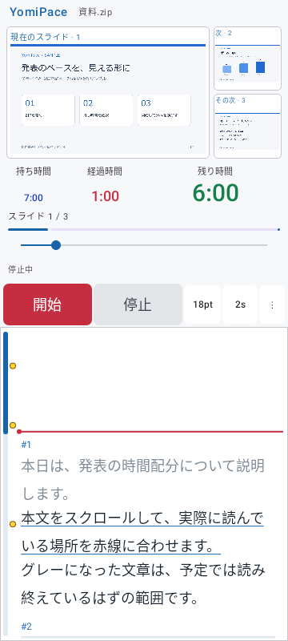
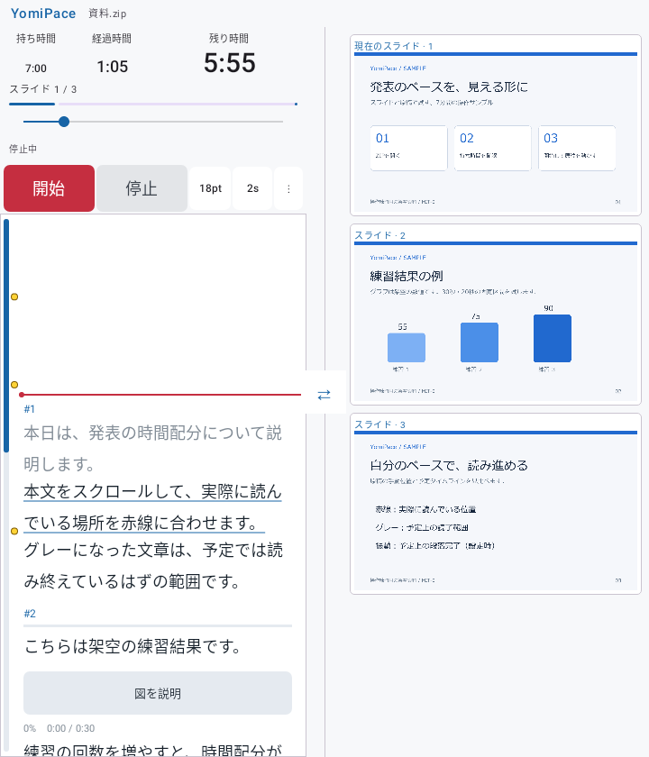
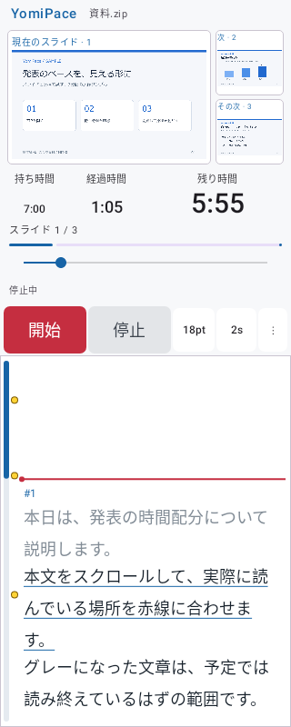

# 0.4.5 時計領域の比率配分と検証

2026-11-02。versionCode 10。0.4.4で時計3項目が左側へ寄っていた表示を修正しました。

## 動作

時計欄の全幅から項目間の間隔を除き、保存したフォントサイズの比率で3領域に配分します。持ち時間12sp・経過時間18sp・残り時間30spなら、領域幅は2:3:5です。見出し・時刻をそれぞれの領域で中央揃えにし、時刻の基準線も揃えます。時計設定範囲を12～72spに広げました。

設定サイズを大きくした項目は領域も広がり、他2項目は狭まります。文字が領域に収まらないときは、各領域に入る最大のサイズへ自動縮小します。表示サイズが下がっても領域の比率は保存設定を基準に保ちます。長い時刻や極端な画面幅では、設定を大きくした項目自身や見出しも必要に応じて縮小します。横スクロール・折り返し・省略は行いません。

設定値は保持するため、広い画面では元の文字サイズへ戻ります。領域配分は0.4.4の実測文字幅を並べる方式から変更しました。旧設定のclockFontPriorityキーは互換性のため保持しますが、領域幅は3つのサイズ設定から決めます。個別の色・スリープ禁止・原稿スクロールバー・シークなどは維持します。

## 表示例

公開用の架空サンプルを使った自動テスト描画です。実機撮影ではありません。







## 検証

| 対象 | 最終結果 |
|---|---|
| Core全体 | 17件、失敗0・エラー0・スキップ0 |
| Debug全体 | 46件、失敗0・エラー0・スキップ0 |
| Release全体 | 46件、失敗0・エラー0・スキップ0 |
| Debug／Release Lint | 各エラー0・警告20件 |
| Release APK生成・CRC | 成功 |
| 署名・zipalign | 成功。0.4.4と同じ配布署名 |
| ネイティブライブラリ | 全4ABIのELF LOAD最小16KiB配置 |

最終全件実行はBUILD SUCCESSFUL（1分34秒）。途中の失敗を含むログ・XMLと最終の証拠を非公開のdocs/evidence/0.4.5/に保持しています。

画面テストでは、12・18・30の設定で各領域の幅が2:3:5（整数ピクセル丸め誤差1px以内）になること、最初と最後の領域が時計欄の左右端へ一致すること、見出しと時刻の中心が揃うこと、時刻の基準線・色・表示内容・超過表示・シーク後の再計算が保たれることを確認します。開いた画面・左右入替・320dpのカバー画面・旧設定・再起動相当での設定保存を含みます。

初回Debugと再実行Releaseで、追加した折りたたみ画面テストの画像待機が各1件タイムアウトしました。時計領域の比率の検証は通過し、その後のスクリーンショット用画像待機で停止しています。各XMLとログを非公開の作業記録に保存しました。折りたたみ切替で新しく作られたプレビューの読込完了を待ってから左右入替するよう、画面テストに同期を追加しました。同期追加後にもReleaseの既存スクロールバー画面テストで同じ種類の待機タイムアウトが1件ありました。その後、画像待機・表示比率の検証を削除・スキップせず全件を実行し、Debug・Releaseとも全46件の成功を確認しました。過去版にも画像待機タイムアウトがあり、根本原因の解消を示すものではありません。

実機への更新インストール、実際のFold開閉と消灯防止はNOT_RUN、Dropbox同期はUNKNOWNです。この機能実装の完了時点ではGitHub公開を行っていませんでした。その後の公開検証は [0.4.5 GitHub公開](0.4.5_GitHub公開と検証.md) を参照してください。

## 他AIでのレビュー用

対象差分はClockAppearance.kt（比率に沿った領域内の文字計測）、MainActivity.ktのClockTimes（全幅のweight配置と中央揃え）、AppViewModel.kt・PlaybackControls.kt（時計の設定範囲）、ClockFitTest.kt・ComposeScreenTest.kt・AndroidBehaviorTest.ktです。

次の観点で、添付ソースとこの記録をレビューしてください。

- 項目間の間隔を除いた全幅が、保存フォントサイズの比率に一致するか。表示時の縮小で配分比が揺れないか。
- 端数ピクセル・異なる文字倍率・非常に長い正負の時刻で文字が見切れないか。見出しと時刻が中央に揃うか。
- 設定サイズを1つ増やすと、その項目の領域が増え、他2つは必要なときに縮小するか。画面幅を戻すと設定サイズへ復帰するか。
- Foldのカバー・メイン縦横・左右入替後も、原稿位置と時計を保持するか。旧設定と新設定の読み込みに互換性があるか。
- Robolectricの画像待機タイムアウトと、実機の表示不具合を区別して評価すること。実機未検証項目を検証済みと扱わないこと。

## 成果物

開発完了時のソースZIPは公開用作業ツリーの書き出しとしてローカルに保持しています。GitHub Releasesでは、公開コミットから生成したソースZIPと、下記ハッシュの署名済みAPKを配布します。旧版を保持し、既存の配布鍵を継続使用します。

APKのSHA-256：

```text
cb3084f9e79056d22e29bae0a8430eb29d830acfc2e118e42b6716f2fae071d4
```

