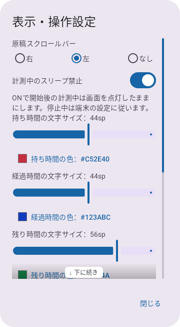
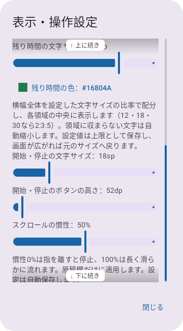
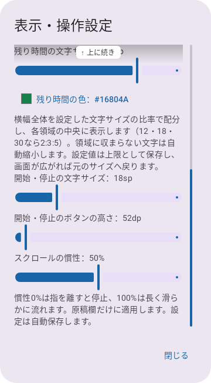
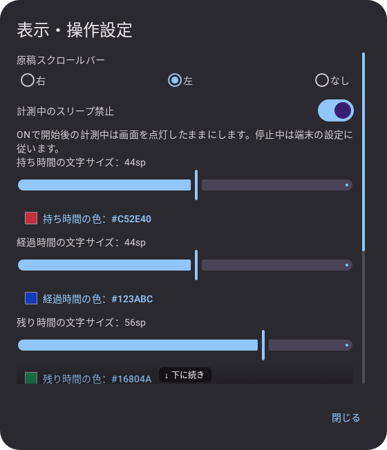

# 0.4.6 設定画面のスクロール案内と検証

2026-11-02。versionCode 11。「表示・操作設定」に続きがあることを分かりやすくしました。

## 動作

- 内容が画面に収まらない場合は、右端にスクロールバーを常時表示します。つまみの長さは表示範囲、位置はスクロール位置に対応します。スクロールを止めても消えません。
- 下に続きがあるときは下端に薄い黒のグラデーションと「↓ 下に続き」、上へ戻れるときは上端に「↑ 上に続き」を表示します。端に到達した方向の影と案内は消えます。途中では上下両方を表示します。
- 本文の指操作、バーのつまみのドラッグ、トラックのタップでスクロールできます。つまみを掴んだ位置を保持し、触れた瞬間の跳びを防ぎます。アクセシビリティの位置変更操作にも対応します。
- バー用の領域を本文の右側に確保し、設定のスライダーと重ならないようにしています。影と案内はタッチを遮りません。「閉じる」はスクロール領域の外に固定しています。
- 明るい／暗いテーマに対応します。内容が全て収まる場合はバー・影・案内を表示しません。

時計の比率配分、色・サイズ・スリープ設定、原稿スクロールバー、原稿の表示位置、シークなどの動作と保存は変更していません。今回の機能に新しい保存設定はありません。

## 表示例

自動テストで描画した設定ダイアログです。実機撮影ではありません。









## 検証

| 対象 | 最終結果 |
|---|---|
| 設定画面の追加テスト | Debug・Release各3件成功 |
| Core全体 | 17件、失敗0・エラー0・スキップ0 |
| Debug全体 | 49件中48成功・画像待機1件タイムアウト（PARTIAL） |
| Release全体 | 49件中48成功・画像待機1件タイムアウト（PARTIAL） |
| Debug／Release Lint | 各エラー0・警告20件 |
| Release APK生成・CRC | 成功 |
| 署名・zipalign | 成功。0.4.5と同じ配布署名 |
| ネイティブライブラリ | 全4ABIのELF LOAD最小16KiB配置 |

全体実行はテスト失敗によりBUILD FAILEDと出力されましたが、--continueによりAPK生成とLintは完了しています。テスト全件成功とは扱いません。

追加のSettingsScrollTestでは、つまみのドラッグ、トラックのタップ、上下端での案内切替、バーの常時表示、つまみに触れた際の位置保持、設定値の変更、色選択ダイアログから戻った際のスクロール位置保持を確認します。360dp幅のカバー画面相当、840×720dpの暗い横画面、800×360dpの短い横画面を含みます。最下部のスクロール慣性設定と、固定の閉じるボタンへ到達できることも検証します。

初回の全体実行はDebugでlargeTabletLandscapeWithScrollableFullWidthSlidesとexpandedScreenSwapsWholeColumnsAndKeepsClockAndPositionの2件、ReleaseでproportionalClocksSurviveFoldSwapAndWidthChangesの1件が画像待機でタイムアウトしました。最終の全体実行はDebug・Releaseの両方でproportionalClocksSurviveFoldSwapAndWidthChangesがタイムアウトし、各48/49件成功です。いずれもComposeScreenTest.waitForImagesの15秒待機であり、今回追加したSettingsScrollTestの失敗ではありません。設定画面の追加3件は両構成で成功しています。

テストを削除・スキップしたり、待機時間・検証条件を緩めたりしていません。初回と最終のXML・ログを非公開のdocs/evidence/0.4.6/へ保存しました。過去版にも画像待機タイムアウトがあり、今回の設定画面変更で根本原因を修正したとは扱いません。

実機でのAPK更新、実際のFold開閉と消灯防止はNOT_RUN、Dropbox同期はUNKNOWNです。機能実装完了時はGitHubへ公開していませんでした。その後の公開検証は [0.4.6 GitHub公開](0.4.6_GitHub公開と検証.md) を参照してください。既存の公開0.4.5は保持しています。

## 他AIでのレビュー用

主な差分はSettingsScrollPane.kt（位置バー・影・案内・タッチ・アクセシビリティ）、PlaybackControls.kt（設定本文のコンテナ差替）、SettingsScrollTest.kt、バージョン情報と説明文です。時計や原稿の計測処理は変更していません。

レビューでは、表示範囲とつまみ位置の計算、端での影の消失、ドラッグ時の跳びと画面幅・高さ変更時の再計算、バーと設定コントロールの干渉、明暗テーマでの見やすさを確認してください。追加した影で操作や読み取りを妨げないか、文字倍率を大きくした場合や色ダイアログから戻った場合も確認対象です。自動テストの成功と未実施の実機検証を分けて評価してください。

## 成果物

開発時のソースZIPはローカルの作業ツリーを書き出した原本として保持しています。GitHub Releasesでは、公開コミットから生成したソースZIPと、下記ハッシュの署名済みAPKを配布します。旧版のAPKとソースZIPは保持します。

APKのSHA-256：

```text
f6de91abc5e2b310ca23a6538927faa8d98b4e9e984f050ca9ef084b6135fbce
```

