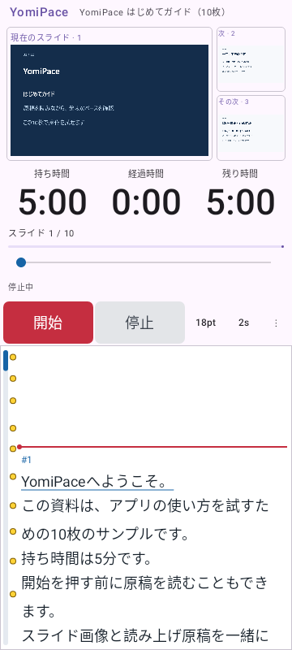
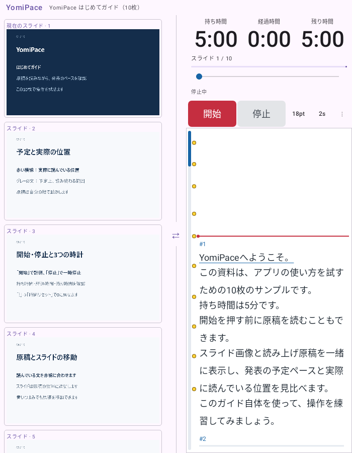
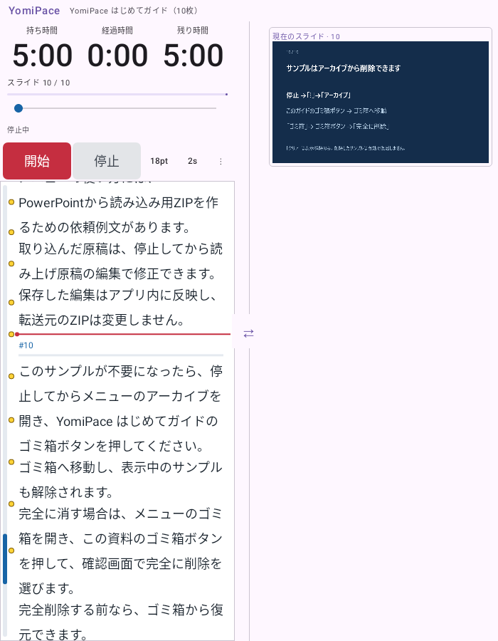

# 0.4.7 初回起動のはじめてガイド

2026-11-02。versionCode 12。新規インストール後の初回起動で、10枚・5分のサンプルを停止状態で開きます。

## 使い方

「開始」を押し、原稿を手動で動かしながら、予定ペースのグレー表示・固定時間のバー・シークなどを試せます。スライドと読み上げ原稿の内容は [はじめてガイド](../samples/welcome/README.md) を参照してください。15秒の固定区間も含みます。

最後のスライドには、停止→「⋮」→「アーカイブ」→このガイドのゴミ箱ボタンで削除できることを記載しました。完全削除は「ゴミ箱」→同じ資料のゴミ箱ボタン→「完全に削除」です。完全削除前は復元できます。「クリア」は表示解除だけです。

通常の取り込み資料と同様にアーカイブへ保存するため、原稿編集・持ち時間変更もできます。編集原稿や再起動後の位置を保持します。クリア・ゴミ箱移動・完全削除のあとに、サンプルを自動再表示・再作成しません。APK内の資産は残りますが、削除したアーカイブに戻す処理はありません。

既存の資料や設定がある版から更新した場合は、現在の利用状態を優先し、自動追加しません。必要なら [10枚のZIP](../samples/YomiPace-welcome.zip) を手動で取り込めます。従来の3枚の練習サンプルは保持しています。

## 実装

WelcomeSample.ktが初回準備を管理し、AppViewModelの保存資料復元より前に実行します。初回準備中の状態を先に保存するため、準備中の画面終了で通常設定が保存されても初回判定を失いません。途中で失敗した場合は次回起動で再試行します。固定の資料IDと状態の一括保存で、重複登録を防ぎます。

アセットはPNG10枚とUTF-8のscript.txtを含むZIPです。ソースの内容と画像・再生成スクリプトをsamples/welcome/とscripts/へ置きました。アプリの通常ビルドでは描画ランタイムを必要としません。ネット権限や追加通信は導入していません。

## 表示例

自動UIテストで描画した画面です。実機撮影ではありません。

| スマートフォン相当の初回表示 | Foldメイン画面相当の初回表示 |
|---|---|
|  |  |

## 検証結果

| 対象 | 結果 |
|---|---|
| Core全体 | 17件中17件成功、失敗0・エラー0・スキップ0 |
| Debug全体 | 62件中58件成功、失敗4・エラー0・スキップ0 |
| Release全体 | 62件中61件成功、失敗1・エラー0・スキップ0 |
| 初回導入・保持・削除など追加テスト | Release13件成功。Debug12件成功・Fold画像待機1件タイムアウト、当該1件の単独再実行は成功 |
| Debug Lint | エラー0・警告23件 |
| Release Lint | エラー0・警告23件 |
| APK生成・CRC・アセット一致 | 成功 |
| 署名・zipalign | 成功。0.4.6と同じ配布署名 |
| ネイティブライブラリ | 全4ABIのELF LOAD最小16KiB配置 |

全体テストの状態は **PARTIAL** です。全体実行の失敗は {"core": [], "debug": ["proportionalClocksSurviveFoldSwapAndWidthChanges", "seekSurvivesFoldSwapAndFontChange", "unfoldedPortraitKeepsTwoColumnsAndClockAcrossFoldUpdates", "welcomeRemainsUsableOnFoldMainScreenInPortrait"], "release": ["scrollbarSettingWorksAcrossFoldSwapAndReaderFontChanges"]} です。既存画面のComposeScreenTest.waitForImagesと、追加したFold画面のWelcomeScreenFixture.captureでの画像待機タイムアウトです。追加Foldの単独再実行は成功しましたが、全体結果を成功へ読み替えていません。画像待機の根本原因が解消したとは扱いません。

追加11件の動作テストは初回導入、10画像の実デコード、原稿と5分の予定表、再起動・編集・位置保持、クリア、ゴミ箱移動・復元・完全削除後の再起動、既存資料・設定の引き継ぎ、中断と再試行、削除後の手動取り込みを扱います。2件の画面テストはスマートフォンの削除操作、Fold相当の縦2列と左右入替を扱います。

検証途中の画面テストは、テスト間でApplicationを保持したファクトリーの使用やReleaseにないホストActivityの問題で失敗しました。現在はMainActivityをホストにして、各テストのApplicationを明示したLifecycle所有のViewModelを使います。ネイティブの画面キャプチャ前にも描画を更新します。過程の失敗ログを保持し、テストや検証条件の削除・スキップはしていません。

実機の新規インストール・上書き更新・Fold開閉・振動・消灯防止はNOT_RUNです。Dropbox同期はUNKNOWNです。

APKのSHA-256：`2a441a633e6cc7509e034442ad213adfd0945a1263581b857695e8b40449a983`
