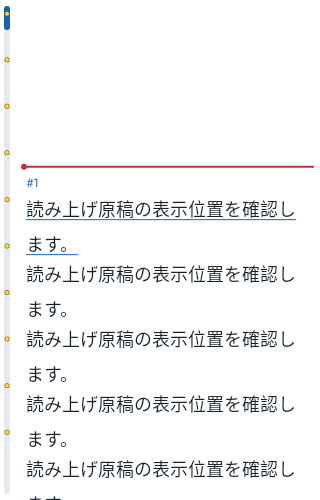
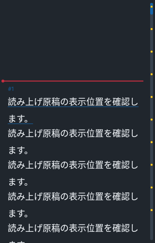

# 0.4.8 バイブの初期値と原稿バー内のスライド開始点

2026-11-02。versionCode 13。

## 変更内容

- グレー表示のバイブは、設定が保存されていない場合にON・中で開始します。既に保存されているOFFや弱・強などの選択は引き継ぎます。振動を無効にする場合は「⋮」→「グレー表示のバイブ」で変更してください。
- 原稿スクロールバーの黄色いスライド開始点と縁取りを、バーの内側に収めました。左右どちらの配置でも、点の中心をバーの中心に合わせます。青いつまみの上にも黄色い点を重ねるので、表示中の範囲にある開始点も見えます。端に近い点も縁取りがはみ出さない位置に収めます。
- バーのドラッグ、つまみに触れたときの位置保持、左右・なしの設定、原稿位置と時計は維持します。「なし」では点も非表示です。
- アプリ内ヘルプ、操作説明、10枚のはじめてガイドの読み上げ原稿も、ON・中の初期値へ更新しました。既にアーカイブに保存した原稿は上書きしません。

## 表示例

ネイティブ原稿Viewを自動テストで描画した画像です。実機撮影ではありません。

| 左側・明るいテーマ | 右側・暗いテーマ |
|---|---|
|  |  |

## 検証

| 対象 | 結果 |
|---|---|
| 今回の追加テスト | Debug・Release各3件成功 |
| Core | 17件中17件成功、失敗0・エラー0・スキップ0 |
| Debug全体 | 65件中64件成功、失敗1・エラー0・スキップ0 |
| Release全体 | 65件中64件成功、失敗1・エラー0・スキップ0 |
| Debug Lint | エラー0・警告23件 |
| Release Lint | エラー0・警告23件 |
| 署名APK・CRC・zipalign | 成功。0.4.7と同じ配布署名 |
| ネイティブライブラリ | 全4ABIのELF LOAD最小16KiB配置 |

追加テストでは、未設定時のON・中と24msの中強度の振動、保存済みOFFと強さの保持・再起動を確認しました。描画は左右・なし、明暗、18/32sp、320/700dp幅で、黄色と縁取りの全画素がバー内に収まること、青いつまみ上でも点が見えることを確認します。既存の点の再配置テストもバー内の描画位置に合わせて更新しました。

全体の状態は **PARTIAL** です。失敗したケースは `{"core": [], "debug": ["welcomeRemainsUsableOnFoldMainScreenInPortrait"], "release": ["proportionalClocksSurviveFoldSwapAndWidthChanges"]}` です。画像待機タイムアウトは以前から記録されている問題で、今回の3件は両構成で成功しています。全体を全件成功とは扱いません。実機での振動の感じ方・更新インストール・Fold開閉はNOT_RUN、Dropbox同期はUNKNOWNです。

APKのSHA-256：`9779d895950b6ba5f6c39770d873b79e0aff9bb508dff6364d3d6dfd1ac93b8c`
