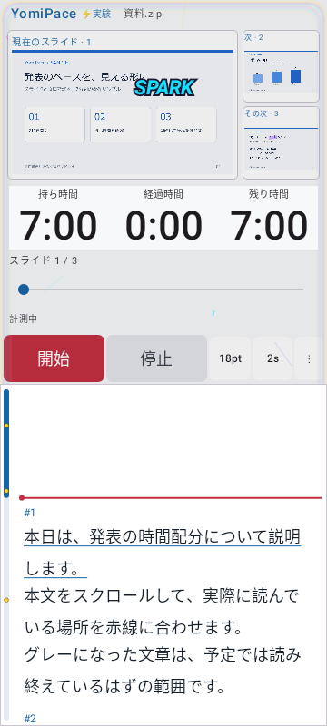
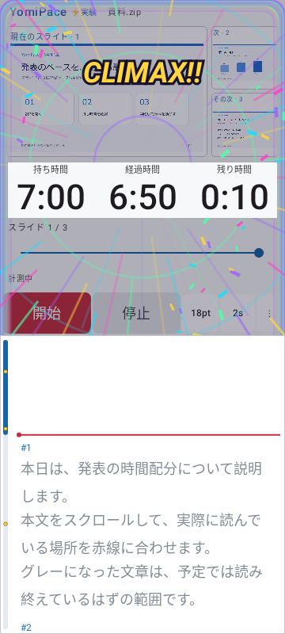
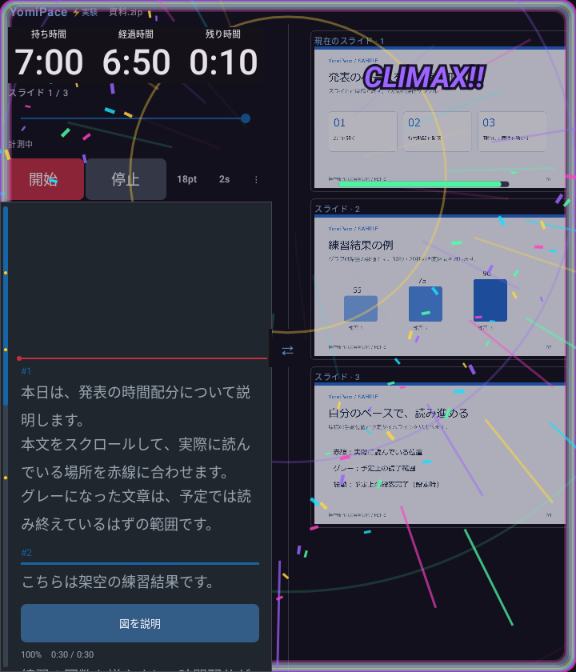

# 0.5.0 実験モード・1本の進捗バー・バイブON移行

2026-11-03。versionCode 14。Android 8.0以降。配布用APKは0.4.8と同じ鍵で署名しています。

## 変更

- 「⋮」→「実験」→「ドパガキモード」を追加（初期OFF、保存あり）。音を使わず、タッチ・スクロールの火花とコンボ、予定上の段落完了のバーストを表示します。発表が進むほど虹色の縁、集中線、紙吹雪、広がるリングと短い振動ビートを増やします。50% BOOST、75% FEVER、90% LIMIT BREAK、97% CLIMAX、超過OVER DRIVEです。原稿位置を動かしても時計や熱量は変わりません。
- 原稿欄と時計3項目を最前面の装飾から切り抜き、文字・背景・位置を演出では変えません。Fold縦2列と左右入替にも追従します。装飾はタッチを消費しません。停止・シークでは自動演出を止め、停止中のタッチは小さな火花だけにします。メニュー・ダイアログ・バックグラウンドでは休止します。
- 演出専用の振動ON/OFFを独立して保存します。最短150msの発火間隔、リピートなしの短い波形を使用します。描画は約30fpsを目標とし、粒子のイベント保持数を24に制限します。実機の達成fps・感じ方は未検証です。
- 時計下の非操作プログレスバーを削除し、直接タップ・ドラッグできる1本へ統合しました。触れた時点で停止し、離しても停止、「開始」で再開します。原稿の手動位置を保持し、グレー表示などの予定進捗を時刻に合わせ直します。超過ではバーの範囲を広げ、注意色で表示します。
- 0.4.8は未設定のときだけバイブONだったため、保存済みOFFが残ることがありました。今回の版は最初の起動で一度ON・中へ移行します。以降に選択したOFF・強さは再起動後も保持します。初回ガイドの新規インストール判定は移行前に記録します。

モードの発想の参考は[ドパ将棋！](https://www.dopasyogi.app/)のテンポのよい連続反応です。画像・音・コードの流用はなく、このアプリ向けの演出を実装しています。

## 描画例

実装の自動UIテストによる描画です。実機録画ではありません。架空の公開サンプルを使用しています。

| 前半のSPARK | 終盤のCLIMAX |
|---|---|
|  |  |

## 検証結果

| 対象 | 結果 | 失敗したケース |
|---|---|---|
| core | 17/17 成功 | 失敗なし |
| debug | 73/74 成功 | dopamineFoldDarkVisualsAndSwap |
| release | 73/74 成功 | welcomeRemainsUsableOnFoldMainScreenInPortrait |
| targeted-debug | 12/13 成功 | dopamineFoldDarkVisualsAndSwap |
| targeted-release | 11/13 成功 | experimentsToggleObserveReaderTouchAndStopOnPause, proportionalClocksSurviveFoldSwapAndWidthChanges |

全体は **PARTIAL** です。今回の新しいFold描画ケースでも、従来から記録されている画像読み込み待ちタイムアウトが発生しました。再確認で失敗するケースも変わっており、根本原因は未解消です。成功した初回のFold描画画像は保持しています。全件成功とは扱いません。検証条件を緩めたり画像失敗を成功へ変更したりしていません。

純粋な演出ロジック3件、原稿・時計への描画侵入がないことを画素で調べる2件は両構成で成功。今回のOFF→ON移行、その後のOFF保存、統合バーの前後タップ・停止・原稿位置保持も検証しました。対象テストは追加9件と既存の移行ケース更新1件です。個別の追加画面テストにも画像待機の制限があり、全10件成功とは記載しません。

Releaseの個別確認では設定保存のassertionも1件発生しました。Robolectricが前のApplicationを持つViewModelファクトリを保持し、テストがActivity側の別Applicationの設定を読んでいたため、ViewModel自身のApplicationを検証するようテストを修正しました。修正後の保存・ON/OFF・停止・バックグラウンド休止の同一ケースはDebug/Release各1件成功しています。元の失敗ログは保持し、画像待機タイムアウトとは分けて扱います。

Debug/Release Lintは各エラー0・警告25件。署名検証、zipalign（16KiB）、APK CRC、4ABIのELF LOAD最小16KiB配置、同梱ガイド一致を検査しています。ソースZIPは全ファイルのハッシュとCRCを照合し、旧0.4.1～0.4.8の配布ファイルも保持・照合します。詳細証拠は非公開作業領域のdocs/evidence/0.5.0/に保持します。

APK SHA-256: `6aabb8bf2f88592493a3169a597fda1ff1a4276b8ba4fbecf96a6b7e25063cb2`

実機の振動・更新インストール・Fold実操作は **NOT_RUN**、Dropbox同期は **UNKNOWN** です。
