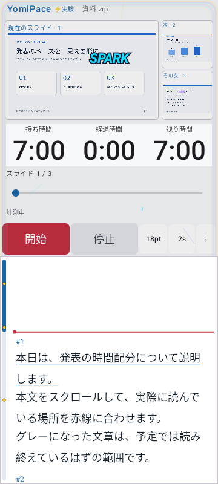
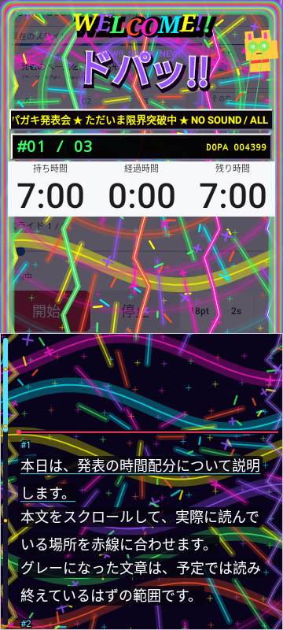
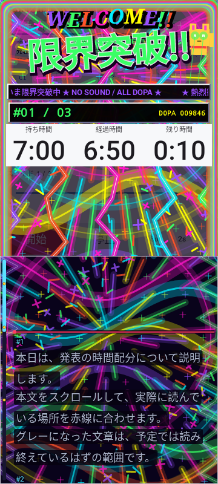
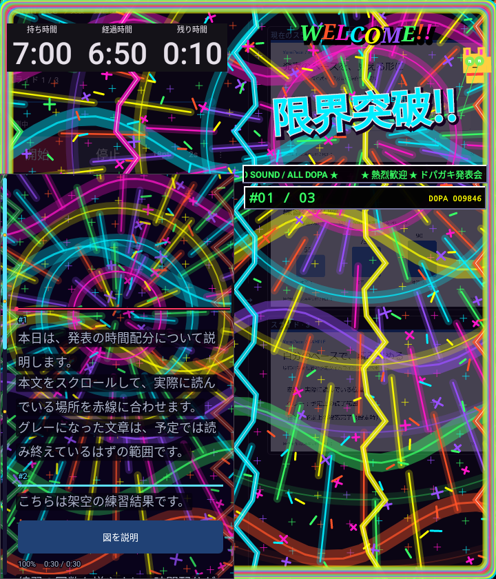

# 0.5.1 ドパガキ増量・レトロWeb・原稿の前景化

2026-11-03。versionCode 15。0.5.0の演出が地味という要望、愛生会病院旧サイトのような古いインターネットのDNA、スライドへの大胆な装飾、動く原稿背景と最前面の文字という追加要望を反映しました。

## 変更内容

- 開始時の熱量を上げ、前半から原色の帯・星柄の壁紙・虹の渦・集中線・紙吹雪・稲妻を表示。終盤ほど速さと量を増やします。時計に変形や装飾を重ねません。
- タッチは60ms単位で火花とコンボへ反応。8コンボごとに追加の大爆発、予定上の段落完了は三方向バーストです。背景ビートは約880ms間隔から終盤260ms間隔へ加速します。発火は最短150ms、振動は短い二連・三連の波形を使います。モードOFF・停止・シーク・バックグラウンドで自動発火を止めます。音は鳴りません。
- 虹色のWELCOME、NEW!!、立体枠、流れる電光テロップ、数字カウンター、目が光って手を振るオリジナルの招き猫を追加。熱量カウンターは演出で、アクセス数を計測しません。
- スライド・操作ボタンを大胆に覆い、別枠の大きな「#01 / 03」表示で、原稿位置に対応する現在スライドと総枚数を確認できます。装飾はタッチを消費しません。
- 原稿は専用のNative背景レイヤーで動かします。その後、行ごとの暗い下地→文字の縁取り→不透明な本文・グレー表示→下線・赤線・原稿バーの順に描きます。ルートの装飾は原稿View全体と時計を切り抜くため、描き終えた文字や時計を上書きしません。演出による文字の拡縮・移動は行いません。
- 通常モードの画素、原稿の論理位置・時計・1本の操作できる進捗バー・各設定を保持。0.5.0のON移行を済ませたユーザーのバイブOFFを再度ONに戻しません。

旧サイトの参考は、黒背景・原色の動く文字・光る目の招き猫を紹介する[J-CASTニュースの当時の記事（ライブドア配信）](https://news.livedoor.com/article/detail/7681296/)、文字の拡縮に触れる[ASCII.jpの紹介](https://ascii.jp/elem/000/000/804/804010/)です。旧サイトの保存ページは取得できなかったため、当時の報道を参考にしました。元サイトの画像・GIF・写真・音源・コードは使用せず、図形と文字から実装しています。

## 自動UIテストの実画面

架空の公開サンプルによる描画で、実機の撮影ではありません。

| 0.5.0 開始時 | 0.5.1 開始時 |
|---|---|
|  |  |

| 0.5.1 終盤 | Fold暗色・左右入替 |
|---|---|
|  |  |

## 検証

| 対象 | 結果 | 失敗したケース |
|---|---|---|
| core | 17/17 成功 | 失敗なし |
| debug | 76/79 成功 | maximumSettingsOnSmallCover, rotationKeepsClockAndLogicalPosition, welcomeRemainsUsableOnFoldMainScreenInPortrait |
| release | 76/79 成功 | proportionalClocksSurviveFoldSwapAndWidthChanges, rotationKeepsClockAndLogicalPosition, welcomeRemainsUsableOnFoldMainScreenInPortrait |

演出ロジック5件・描画3件・原稿前景2件の計10件はDebug/Releaseともに成功。開始時の熱量、連続バースト、コンボ大爆発、停止と消去、装飾の上限、時計と原稿Viewの外部装飾からの保護、背景だけが動き不透明な文字画素と論理位置が変わらないこと、通常モード・非表示時の原稿が従来と画素単位で一致することを検証しました。

0.5.0の開始時を固定して保存した比較用PNGと、同じ360×800・時刻・切り抜き条件の0.5.1を比較。RGBいずれかが150を超える装飾レイヤーの画素は540→41,890でした。特定の1フレームの比較であり、印象や実機性能の倍率を表す数値ではありません。

カバー・Fold暗色・左右入替の追加UI描画2ケースも成功。通常モードでは赤い開始ボタンの可視性を従来どおり検査します。実験モードは要望に合わせてボタンへの装飾を許可し、意味情報とタッチ操作を維持します。

全体は **PARTIAL**。上表の3件ずつは画像読み込み待ちのタイムアウトで、以前から断続的に記録されている現象です。原因未解消で、全件成功とは扱いません。条件を緩める再試行はしていません。通常モードを含む未確認の実機挙動は別途残ります。

両Lintはエラー0・警告29件。配布署名は0.5.0と一致。APK CRC・zipalign（16KiB）・全4ABIのELF LOAD最小16KiB配置・同梱ガイド一致・旧0.4.1～0.5.0の配布物保持とハッシュを検証。描画は約30fpsを目標とし、同時イベントは32に制限、同色の粒子や集中線はPathへまとめます。実機の達成fps・振動の感じ方は検証していません。

APK SHA-256: `6d03269e98ec720a7c75202a1a87b8a550b12e6718507e487c33c9b3ebda4198`

詳細ログ・XML・署名記録は非公開作業領域のdocs/evidence/0.5.1/に保持。実機の更新・振動・Fold開閉は **NOT_RUN**、Dropbox同期は **UNKNOWN** です。

## 公開後のSDK互換修正（main）

GitHub側の新しいSDKでは、`StaticLayout.Builder.setBreakStrategy` の定数検査が `LineBreaker` の名前を要求し、既存の `Layout.BREAK_STRATEGY_HIGH_QUALITY` がWrongConstantになりました。[Layout側](https://developer.android.com/reference/android/text/Layout#BREAK_STRATEGY_HIGH_QUALITY)と[LineBreaker側](https://developer.android.com/reference/android/graphics/text/LineBreaker#BREAK_STRATEGY_HIGH_QUALITY)はいずれも値1です。mainでは参照名をLineBreakerへ修正しています。Lintの抑制や基準緩和は行っていません。

修正前後のScriptReaderViewのコンパイル済みクラスは、Debug/ReleaseともSHA-256と全バイトが一致しました。両Lintもエラー0・警告29です。Android 8.0で呼ぶ新しい実行時APIは増えず、原稿の描画・改行・演出・操作は同一です。

公開済みのv0.5.1タグ・署名APK・配布ソースZIPは作成時の内容を保持し、書き換えていません。タグのコミットは0545a64d2b00bf055d67ecf6da6a2e2601134c70です。mainにはこのSDK互換修正が後続するため、mainと公開タグのSHAは区別してください。ソースから新しいSDKのLintも実行する場合はmainの修正を利用できます。
