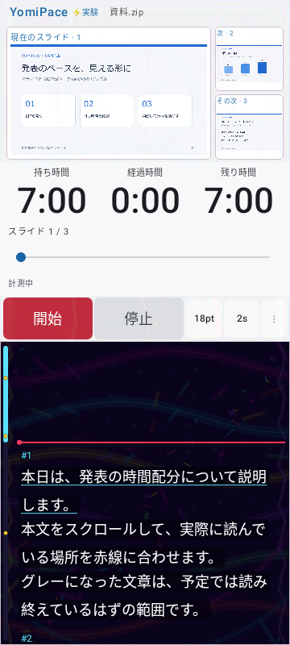
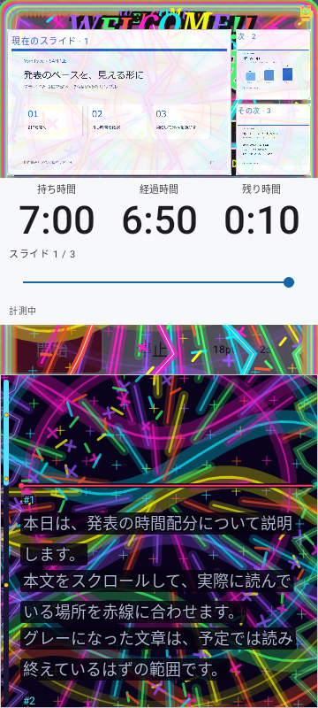
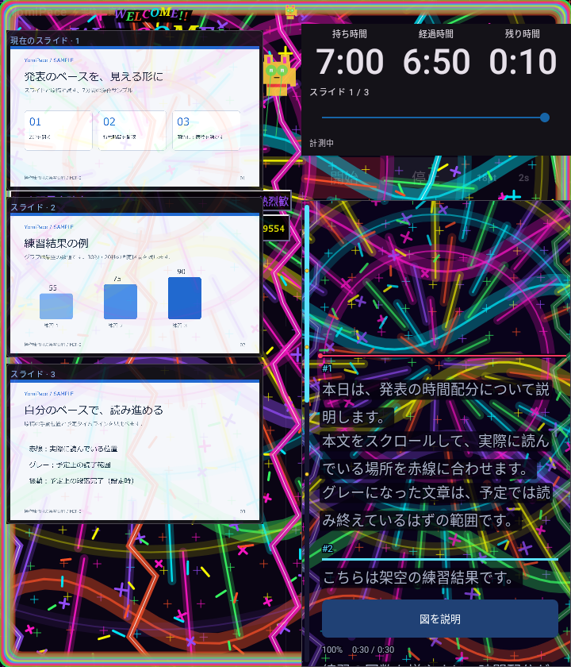
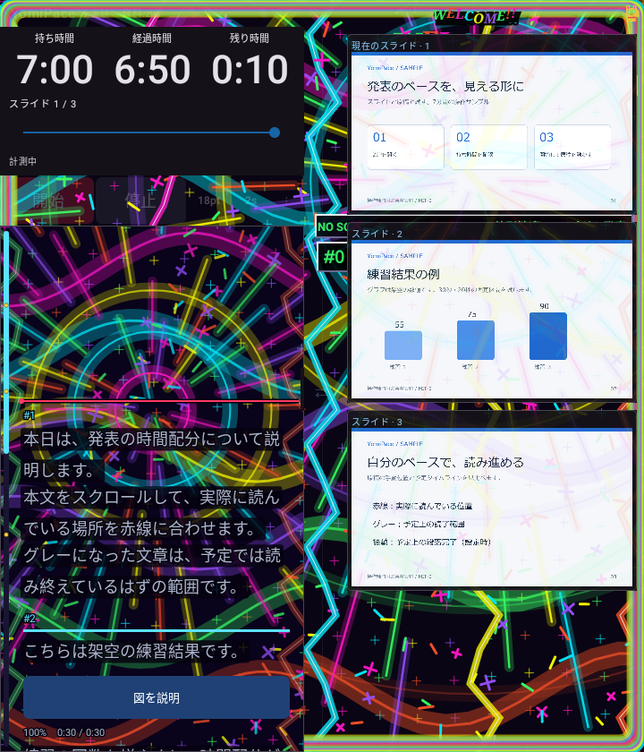

# 0.5.2 段階演出・巻き戻し・振動ビート

0.5.1の開始直後の派手さを抑え、発表の経過時間に応じて徐々に強くします。時間を巻き戻したときは、その時間の強さへ戻ります。

## 設定と振る舞い

- 「実験」内の「演出の強さ」は30～100%（10%刻み、初期100%）で、終盤の最大値を調整します。
- 「盛り上がる速さ」は「じわじわ」「標準」「早め」。初期は標準です。どれも開始時は小さな火花から始まります。
- 演出は経過時間÷持ち時間から計算し、原稿の手動スクロールや過去の最高到達時間では変わりません。超過は最大値に制限します。
- 巻き戻し・弱い設定への変更で、以前の花火・コンボ・拍を消します。シーク中は停止し、「開始」でその時間から再開します。
- 「振動ビート」は個別ON/OFF、初期ON。演出の振動ONかつ計測中に、72→180 BPMで加速する単発振動を刻み、4拍ごとに強拍にします。最大34msで、繰返し波形は使いません。
- ビートON中はタッチ・段落の振動を重ねず、拍を保ちます。ビートOFFではタッチと予定段落完了だけ振動します。演出の振動OFFなら両方止まります。
- 停止・設定画面・メニュー・バックグラウンドで自動演出とビートを止め、復帰時に過去の拍をまとめて鳴らしません。設定は再起動後も保存します。

## 読みやすさ

時計欄全体（スライド番号・進捗バー・計測状態を含む）はRootエフェクトの描画範囲から除外します。バーのタップ・ドラッグ、操作時の停止、原稿位置の独立は保持します。

スライドは通常の画像と番号を表示し、その上は最大12%の薄い粒子・線だけにします。大きな文字・花火・暗幕は重ねません。画面周辺と後半の小さなWELCOME・招き猫でレトロな雰囲気を残します。

原稿は0.5.1と同じ文字・グレー表示・暗い行下地・縁取り・赤線の順序を維持します。背景だけが時間に応じて強くなり、文字サイズや論理位置を動かしません。Foldの縦2列と左右入替も維持します。アプリは無音です。

## 画面例

| 序盤 | 終盤 |
|---|---|
|  |  |

| Fold暗色・終盤 | 左右入替 |
|---|---|
|  |  |

画像はRobolectricのNative描画です。実機撮影ではありません。

## 検証

Coreは17/17件成功。演出エンジン8件・描画4件・原稿2件に、設定UI・新しいモデルへの保存復元と短い振動・実際の進捗バーによる巻き戻しの3件を加えた17件は、Debug/Releaseとも成功しました。

標準曲線の序盤→中盤→終盤の描画増加、巻き戻しで同じ静かな描画へ戻ること、コンボと花火の消去、4拍の強拍、タッチでビートを乱さないこと、停止/バックグラウンド/ミュート、スライドの色変化上限、時計欄の画素非変更、原稿の不透明文字と論理位置、通常モードとの画素一致を確認しました。

最終の全体テストはDebug84/85、Release83/85でPARTIALです。DebugはwelcomeRemainsUsableOnFoldMainScreenInPortrait、ReleaseはdopamineFoldDarkVisualsAndSwapとseekSurvivesFoldSwapAndFontChangeの画像待機タイムアウトが残っています。条件を緩めず結果を保存しました。初回のテスト間で新設定が残った2件は、テスト終了時に設定を戻す修正後に成功しています。

両Lintはエラー0・警告29。署名APK生成・署名継続・zipalign・ZIP CRC・4ABIのELF最小16KiB配置・旧リリースのハッシュ照合は成功しています。versionCodeは16です。実機での振動・更新・Fold操作はNOT_RUN、Dropbox同期はUNKNOWNです。

旧版のAPK・公開タグ・動画は保持します。
