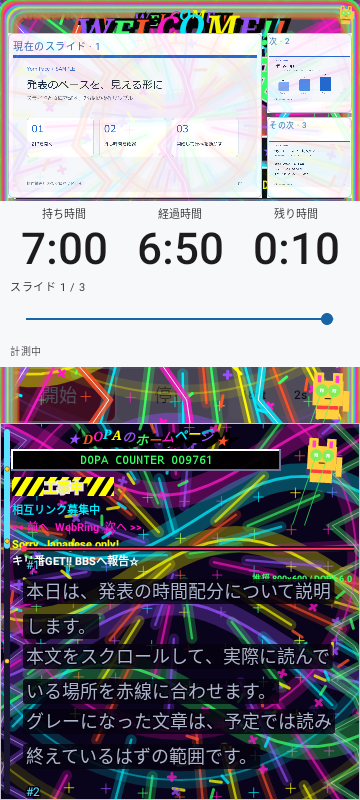
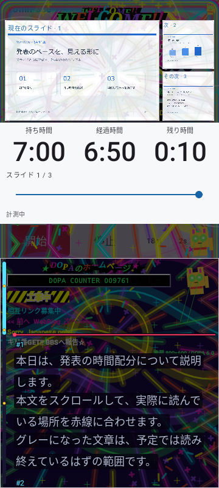
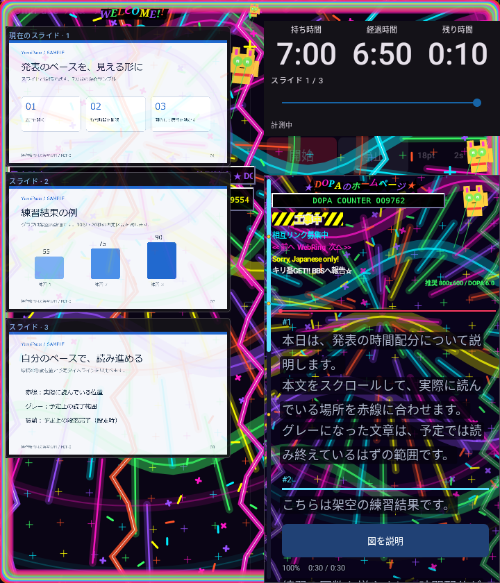
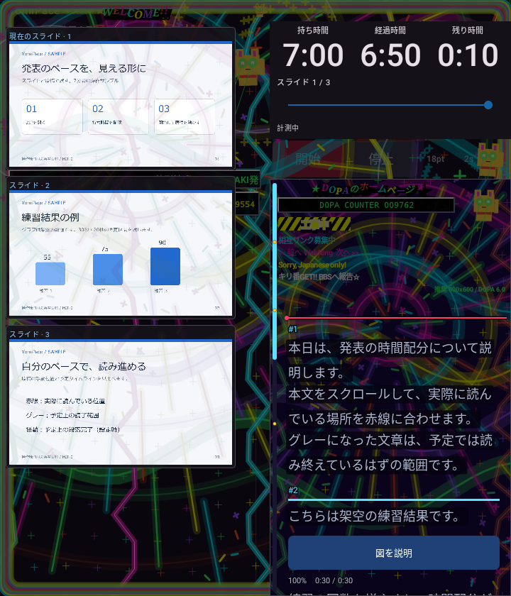

# 0.5.3 DOPAGAKI・招き猫・シェード

モード名を「DOPAGAKIモード」、演出内の表記を「DOPA」に統一しました。

招き猫はスライドの保護領域に隠れていました。時計欄と原稿欄の間の操作ボタン付近に、保護領域を避けて描く招き猫を追加。原稿背景にも招き猫を置き、序盤から存在が分かるようにしました。文字と赤線は猫より前面に描きます。

個人ホームページ風に、虹文字の見出し、DOPA COUNTER、キリ番GET、工事中の黄黒帯、相互リンク募集中、WebRing、足あとBBS、踏み逃げ厳禁、Sorry, Japanese only!、推奨800x600を追加しました。カウンターは発表の進行に応じた遊びの数値で、実際の訪問者の計測ではありません。リンクやBBSは装飾で、外部への接続・送信はしません。猫はオリジナル描画です。

## シェード

「実験」→「DOPAGAKIモード」→「演出のシェード」で0～100%（10%刻み）を選びます。初期は0%。0%はネオンの原色をそのまま、100%は暗い色へ調整します。保存済みの値は再起動・画面開閉後も維持します。

0.5.2の演出全体を半透明にする処理を変更し、段階的な盛り上がりは粒子・線・リング・稲妻の数、大きさ、速度で表現します。序盤の少量の火花から終盤の密度へ徐々に増やし、巻き戻しでその時点の密度へ戻します。シェードは演出レイヤーの色だけを暗くし、経過時間・ビート・コンボ・原稿位置を変更しません。

原稿の文字下地・縁取り・文字色・グレー表示・赤線は0.5.2のままです。時計欄全体と進捗バーは演出から保護し、スライド上の装飾も最大12%を維持します。シェード0%でも保護は外れません。振動ビートと強さ・盛り上がる速さの設定は維持します。アプリは無音です。

## 検証

Core17/17、演出エンジン・描画・原稿の17件と設定UI・保存復元/単発振動・進捗バーの3件を合わせた20件はDebug/Releaseとも成功。全体はDebug83/88、Release85/88でPARTIALです。両Lintエラー0・警告各30。署名継続・zipalign・CRC・4ABIのELF16KiB配置・旧配布物のハッシュ照合は成功。versionCode17です。

画像待機の失敗は条件を緩めず記録しています。

- core: なし
- debug: proportionalClocksSurviveFoldSwapAndWidthChanges, maximumSettingsOnSmallCover, dopamineFoldDarkVisualsAndSwap, seekSurvivesFoldSwapAndFontChange, welcomeRemainsUsableOnFoldMainScreenInPortrait
- release: proportionalClocksSurviveFoldSwapAndWidthChanges, maximumSettingsOnSmallCover, seekSurvivesFoldSwapAndFontChange

猫の黄色い画素がスライド・時計・原稿の保護範囲に隠れず表示されること、シェード0%で原色が復帰し100%で暗くなること、前景の不透明文字と原稿位置が変わらないことを検証しました。実機の更新・振動・Fold開閉はNOT_RUN、Dropbox同期はUNKNOWNです。旧リリース・旧動画を保持します。

## 画面例

| シェード0% | シェード70% |
|---|---|
|  |  |

| Fold・0% | Fold・70% |
|---|---|
|  |  |

画像はRobolectricのNative描画で、実機撮影ではありません。検証ログ・XMLは非公開の作業領域へ保持しています。
