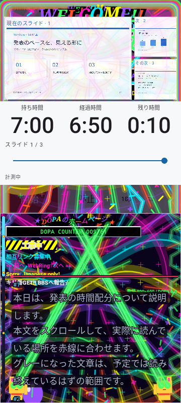
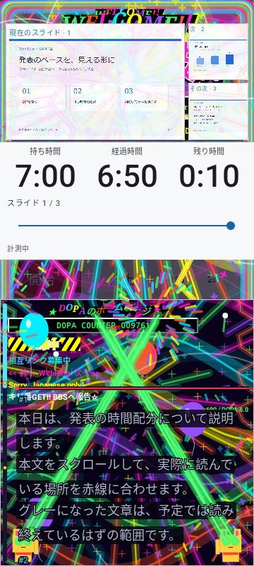
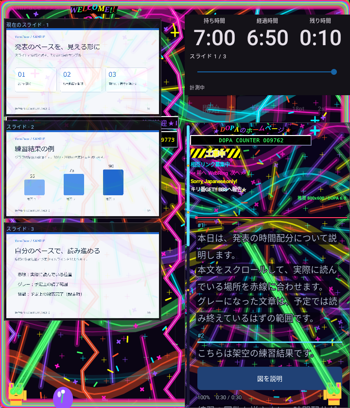
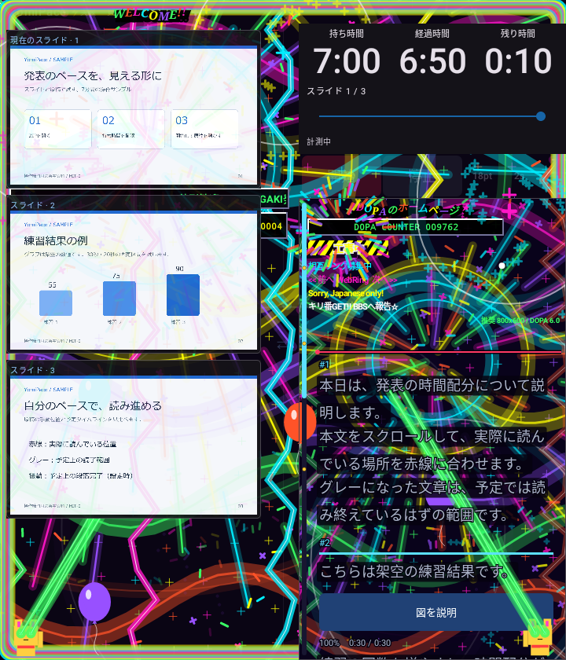

# 0.5.4 DOPAGAKIパーティ演出・カーブ・ビート猫

触った場所で弾ける火花、クラッカーから飛ぶ紙吹雪、浮かぶ風船、上昇して空中で開く花火を追加しました。原稿欄は画面全体の座標へ対応させ、指の位置で反応します。後半は自動の風船・花火も増えます。原稿から上がる花火は時計の背後に隠れないよう、原稿欄の上部で開きます。

風船・花火・紙吹雪は有限のイベントで、途中で停止・巻き戻し・モードOFF・バックグラウンドへ移ると全て消えます。異なる寿命の粒子が混在しても古い火花を消し、保持数を最大32件に制限します。タッチの振動をビートへ重ねない設定、シェード、無音の動作は維持します。

## 盛り上がりカーブ

「盛り上がる速さ」を「盛り上がりカーブ」へ整理しました。演出の強さは予定時間に到達した時の最大値です。どのカーブも開始値と到達値が同じで、途中の曲がり方だけが変わります。標準は直線です。

| 選択 | 進行pに対するカーブ | 見た目の方向 |
|---|---|---|
| 標準 | p | 直線的に増える |
| 前半型 | sqrt(p) | 早めに上がり、その後ゆっくり最大へ |
| 後半型 | p² | 前半は抑え、後半で伸びる |

開始時は小さな火花の5%を残し、設定した最大値まで上記のカーブで補間します。100%なら予定時間ちょうどで最大、超過後は最大を維持します。粒子・線・リングの数にも同じ強さを使用し、標準に追加の二乗カーブを掛けません。設定画面には選んだ曲線のプレビューを表示します。保存済みのカーブ選択は引き継ぎます。

## 下側の両端で踊る招き猫

招き猫を画面下側の左右へ移しました。振動と同じビートの時刻からジャンプと手招きのポーズを計算し、両端が同じ拍で動きます。進行75%以降は目のビームが伸び、予定時間で最大になります。原稿を手でスクロールしても拍やカーブは変わりません。

猫が行の暗い下地に隠れないよう、下地→猫→縁取り付きの不透明な文字→赤線・原稿バーの順で描きます。固定時間のブロックも文字を前面へ保ちます。時計欄と進捗バーは引き続き保護。スライド上のパーティ演出は最大12%の薄さを維持します。猫・ビーム・粒子はシェード設定に従います。

明るくコミカルに拍で跳ね、お祝いが連鎖する方向へ調整しました。ユーザーが挙げた雰囲気の参考：[スーパーマリオブラザーズ ワンダー 公式紹介](https://www.nintendo.com/jp/character/mario/history/wonder/index.html)。アプリ内の猫・演出は独自の描画です。

## 検証

Core17/17、演出エンジン・描画・原稿の22件と設定UI・保存復元/単発振動・進捗バーの3件を合わせた25件はDebug/Releaseとも成功。全体はDebug89/93、Release91/93でPARTIALです。両Lintエラー0・警告各33。署名継続・zipalign・CRC・4ABIのELF16KiB配置・旧配布物のハッシュ照合は成功。versionCode18です。

画像待機の失敗は条件を緩めず記録しています。

- core: なし
- debug: proportionalClocksSurviveFoldSwapAndWidthChanges, maximumSettingsOnSmallCover, dopamineFoldDarkVisualsAndSwap, welcomeRemainsUsableOnFoldMainScreenInPortrait
- release: seekSurvivesFoldSwapAndFontChange, welcomeRemainsUsableOnFoldMainScreenInPortrait

タッチ座標の対応、異なる寿命の消去、カーブの直線性と共通の到達値、ビート猫、前景文字と原稿位置、描画保護を検証しました。実機の更新・振動・Fold開閉はNOT_RUN、Dropbox同期はUNKNOWNです。旧版・旧動画を保持します。

## 画面例

| 終盤 | タッチ演出 |
|---|---|
|  |  |

| Fold・終盤 | Fold・タッチ演出 |
|---|---|
|  |  |

画像はRobolectricのNative描画で、実機撮影ではありません。検証ログ・XMLは非公開の作業領域へ保持しています。
