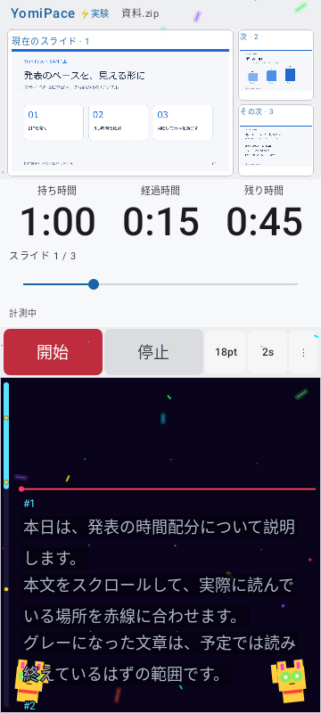
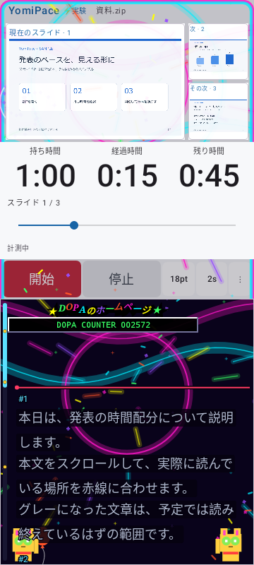
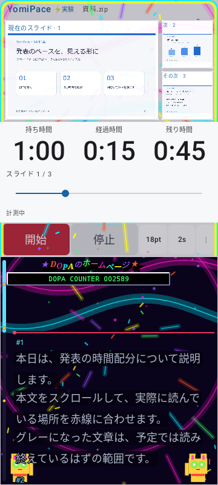
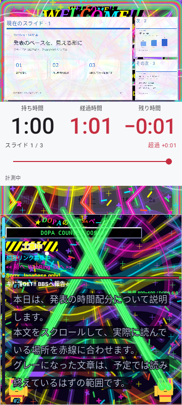

# 0.5.5 自然再生で演出が更新されない不具合の修正

報告された「時間を進めても派手にならず、シークすると急に強くなる」動作を、0.5.4の実際のMainActivityを起動するUI自動テストで再現しました。RobolectricのAndroid仮想時間を進めています。実機での試験ではありません。

## 再現と修正後の値

持ち時間60秒、標準の直線カーブ、強さ100%。演出の強さは最初5%、予定時間で100%です。

| 操作・時点 | 修正前の演出 | 修正後の演出 | 期待値 |
|---|---:|---:|---:|
| 開始 | 5.0% | 5.0% | 5.0% |
| 自然再生 約15秒 | 5.0%で固定 | 28.7% | 28.7% |
| その時刻へシーク | 29.6%へ更新 | 29.6% | 29.6% |
| 再開後 約31秒 | 29.6%で固定 | 54.1% | 54.1% |

時刻の細かな差は時計のポーリングと画面取得によるものです。同じ試験手順で比較し、各時点の実際の時計から期待値を求めています。自然再生の不一致を修正前に検出し、同じテストが修正後に成功しました。

## 原因

DopamineStageが経過時間や演出設定をSideEffectの中で読んでおり、その読み取りが当該Composableの状態監視になっていませんでした。子の時計や進捗バーは更新されても、演出エンジンへ渡す強さは古いままでした。一方シークはViewModelから強さを直接更新するため、症状が表面化していました。

必要な時計・設定・原稿領域をコンポジション内で読み取り、その値をSideEffectへ渡すよう修正しました。時計やカーブの数式、手動の原稿位置、保存データは変更していません。

以前のエンジン単体テストやPR用素材は時刻を直接設定しており、自然再生の画面連携を検証できていませんでした。この経路をMainActivityの回帰テストへ追加しました。

## 検証

- 実際の「開始」操作から15秒間、シークせず時計を進める。
- 同じ時刻へシークした場合と比較し、その後の自然再生も継続して確認。
- カーブ変更・巻き戻し・停止再開・Activityの停止/復帰後も更新されることを確認。
- 自然に予定時間へ到達して強さ100%になること、原稿の手動位置が動かないことを確認。

上記2ケースはDebug/Releaseの個別実行で各2件成功しています。最終の全体テストでも両ケースがDebug/Releaseとも成功。従来の演出・設定・シーク等を含む機能関連27件が両構成で成功しました。Core17/17、全体Debug94/95・Release93/95で画像待機によりPARTIAL、両Lintエラー0・警告33。署名・zipalign・CRC・4ABIのELF16KiB配置・旧配布物のハッシュ照合も成功しています。

実機の更新・振動・Fold開閉はNOT_RUN、Dropbox同期はUNKNOWN。旧版のタグ・APK・PR動画は保持します。

[修正前の数値](live-clock-055/before.csv) / [修正後の数値](live-clock-055/after.csv)

| 修正前：自然再生 | 修正後：自然再生 |
|---|---|
|  |  |

| 修正前：シーク後だけ変化 | 修正後：予定時間で最大 |
|---|---|
|  |  |
