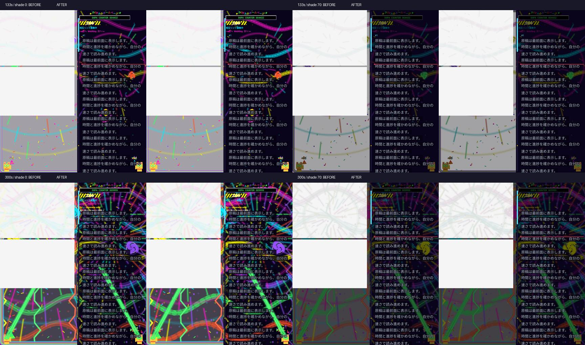

# 0.5.6 DOPAGAKIの描画負荷を改善

演出の種類・個数・色・動く範囲・盛り上がりの数式は維持し、描画の重複とCPU側の仕事を減らしました。アプリは従来どおり無音です。

## 変更

- 原稿の文字と行の下地を描画命令として保持。背景が動いても文字のStaticLayoutを毎フレーム描き直しません。文字サイズ・画面サイズ・原稿位置・灰色表示・固定時間ブロックの進捗など、見える内容が変わると更新します。文字、赤線、スクロールバーは演出より手前です。
- 星・放射線・紙吹雪・火花・花火の線分を、毎フレーム組み立てる大きなPathからCanvasの線描画へ変更。同じ座標・本数・色を使います。線の交点・つなぎ目のアンチエイリアスには小さな差があります。
- 画面全体と薄いスライド装飾で共通する背景の計算・描画命令を再利用。保護領域のPath演算はレイアウト変更時だけ行います。
- シェードの色調整を個々の描画へ適用し、通常の描画で画面全体の一時レイヤーを作らないよう変更。スライド装飾の最大12%の上限は保持します。
- 画面と原稿の独立した33msタイマーを、共有する画面同期の更新へ変更。表示の更新機会に合わせ最大約60回/秒で進めます。停止・バックグラウンドでは継続的な描画を止めます。
- 経過時間と設定はsnapshotFlowで監視し、画面全体を再構成せず演出エンジンへ反映。自然な時間経過で強くなり、巻き戻すと弱くなる動作を維持します。

Android 10以降のハードウェア描画ではRenderNode、Android 8/9またはソフトウェアCanvasではPictureで描画命令を保持します。大きな背景ビットマップの常駐キャッシュは追加していません。

## 同条件の比較

0.5.5の描画クラスを固定し、新版と同じ原稿・時刻・イベント・画面サイズで交互に実行しました。1080×1200、原稿部分510×1200、各実装8回のウォームアップ後40回。RobolectricのNativeグラフィックスによるPC上のソフトウェアCanvas比較です。アプリ全体のフレーム時間や実機のGPU/FPSを表す数値ではありません。

| 演出の強さ | シェード | 旧版中央値 | 新版中央値 | 処理時間の減少 |
|---|---:|---:|---:|---:|
| 47.1% | 0% | 13.93ms | 10.28ms | 26.2% |
| 47.1% | 70% | 23.07ms | 10.89ms | 52.8% |
| 100% | 0% | 22.08ms | 20.24ms | 8.3% |
| 100% | 70% | 29.80ms | 21.48ms | 27.9% |

4場面とも不透明な原稿文字21,843画素は完全一致。RGB差の全画面平均は0.45～2.25/255。シェード0%の高彩度・高輝度の画素数は減っていません。線分の重なる場所の見え方の微差はありますが、演出を間引いた結果ではありません。

通常モードは明暗2種類・文字サイズ2種類・原稿位置2種類・経過時刻8種類の64場面で旧版と完全な画素一致を確認しました。固定時間ブロックとスライド切り替えの進捗も含みます。

キャッシュの回帰テストでは背景が変化する60回の描画で文字と行下地の記録は各1回。灰色表示、通常モードへの復帰、配色、フォント、原稿位置を変更すると再記録されることも確認しています。画面とスライドが共用する背景は1フレーム1回、保護領域の再計算はレイアウトが変わったときだけです。

[計測データ](rendering-056/timings.csv) / [集計と測定条件](rendering-056/summary.json) / [画素比較](rendering-056/pixels.csv)

## 検証範囲

自然再生での演出の増加、予定時間で最大値、巻き戻し・停止再開・カーブ変更・Activity停止復帰の回帰テストも成功しています。提供いただいた端末録画はローカルでの症状確認に使用し、公開ソースや配布物へは含めていません。

Core17/17、Release全99/99、描画・演出関連26件と自然再生の2件はDebug/Releaseとも成功。Debug全体は97/99で、既存の画像読み込み待ちのタイムアウト2件によりPARTIALです。両Lintエラー0・警告33。APKは署名の継続、zipalign、ZIPのCRC、4ABIのELF16KiB配置、旧配布物のハッシュ保持を確認しています。

実機のフレーム時間・GPU負荷・発熱・録画を伴わない滑らかさはNOT_RUNです。この比較だけから実機60FPSや処理落ちの完全解消とは断定できません。実機の振動・Fold開閉もNOT_RUN、Dropbox同期はUNKNOWNです。

描画方針の参考：[Androidの遅いレンダリングの診断](https://developer.android.com/topic/performance/vitals/render)、[ハードウェアアクセラレーションと描画命令](https://developer.android.com/topic/performance/views/hardware-accel-views)、[Composeの状態読み取りとフェーズ](https://developer.android.com/develop/ui/compose/performance/phases)。
