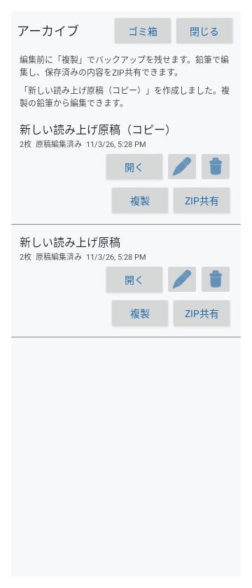
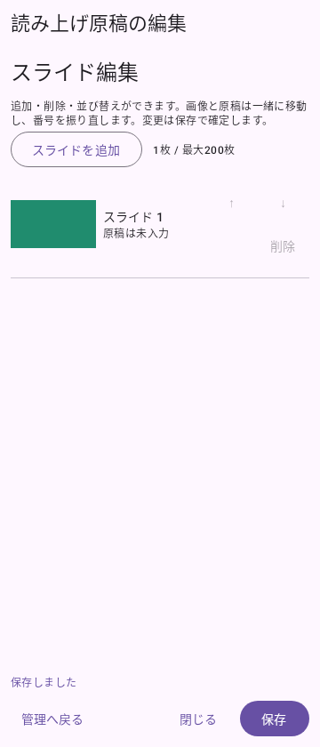

# 0.8.0 スライド編集と複製・ZIP共有

2026-11-03。versionCode 26。「スライド順」を「スライド編集」へ変更し、画像と原稿の並び替えに加えて追加と削除を実装しました。アーカイブには複製とZIP共有を追加しています。

## 操作

- 「スライド編集」→「スライドを追加」で画像を選び、選択順に末尾へ追加。空の原稿を用意し、番号は自動で設定します。
- 各行の「削除」は確認ダイアログの「削除する」で画像と対応原稿を取り除きます。キャンセルなら維持。1枚以上、最大200枚です。
- 画像・本文・メモ・固定区間を一緒に動かし、追加・削除・並び替えと本文等を保存時にまとめて確定します。保存しないで閉じた場合は最後の保存状態を保持します。
- アーカイブの「複製」は保存済みの画像・順序・原稿・発表時間を持つ別資料を作ります。複製した資料を編集すると元をバックアップとして残せます。
- 「ZIP共有」は現在の保存内容から連番PNGとscript.txtを作り、Androidの共有先選択へ渡します。古い取り込み元ZIPは使いません。未保存の変更は含めません。

19枚・9分30秒の初回ガイドに、複製後の編集が安全であること、スライド追加・確認付き削除、ZIP共有を追加。既存のガイドを自動更新・再作成しない仕組みを保ち、更新利用者は[ガイドZIP](../samples/YomiPace-welcome.zip)を手動取り込みできます。

## 保存と互換性

スライド数が変わる保存では、アプリ所有のrevisions下へ新しいPNGセットを全て準備し、画像セットへの参照・枚数・原稿等をentry.jsonの原子的な置換で確定します。準備や原稿検証に失敗しても直前の保存資料を保持します。元ZIP・元画像・元script.txtは変更せず、旧版のimageOrderと既存資料も読み込めます。表示中のスライドが残れば位置と停止中の経過時間を保持し、削除した場合は近くの有効なスライド先頭へ移動します。別資料の編集や複製では発表中の資料を切り替えません。

複製は独立した画像ファイル・保存状態を持ち、元の資料と共有しません。ZIP共有はアプリ専用キャッシュのshared-zipsだけをFileProviderに公開し、共有するZIPのcontent URIに一時的な読み取り許可を付けます。書き込み許可や外部ストレージ全体への権限は付けません。

## 検証

Core28/28、作成・編集・複製・共有の関連テストはDebug/Release各34/34成功。初回ガイド関連はdebug 13/13, release 12/13。全体はdebug 134/136, release 132/136でPARTIAL。既存の画像待機タイムアウトは {"core": [], "debug": [{"suite": "jp.cn22.yomipace.ComposeScreenTest", "case": "proportionalClocksSurviveFoldSwapAndWidthChanges", "type": "androidx.compose.ui.test.ComposeTimeoutException"}, {"suite": "jp.cn22.yomipace.ComposeScreenTest", "case": "maximumSettingsOnSmallCover", "type": "androidx.compose.ui.test.ComposeTimeoutException"}], "release": [{"suite": "jp.cn22.yomipace.ComposeScreenTest", "case": "proportionalClocksSurviveFoldSwapAndWidthChanges", "type": "androidx.compose.ui.test.ComposeTimeoutException"}, {"suite": "jp.cn22.yomipace.ComposeScreenTest", "case": "maximumSettingsOnSmallCover", "type": "androidx.compose.ui.test.ComposeTimeoutException"}, {"suite": "jp.cn22.yomipace.ComposeScreenTest", "case": "dopamineFoldDarkVisualsAndSwap", "type": "androidx.compose.ui.test.ComposeTimeoutException"}, {"suite": "jp.cn22.yomipace.WelcomeFoldScreenTest", "case": "welcomeRemainsUsableOnFoldMainScreenInPortrait", "type": "androidx.compose.ui.test.ComposeTimeoutException"}]}。両Lintエラー0、警告 {"debug": {"errors": 0, "warnings": 33}, "release": {"errors": 0, "warnings": 33}}。署名継続、zipalign 16KiB、4ABI、CRC、APK内ガイド19枚との全バイト一致を確認しました。ZIPの再取り込み、複製の独立性、共有IntentのMIME・URI・読み取り許可・実ファイル読み取り、公開対象外ファイルを共有URIにできないことも確認。実機のメディア選択・共有先アプリでの転送・更新・Fold開閉はNOT_RUN、Dropbox同期UNKNOWNです。

WindowsのRobolectricではAndroidX内部のAndroid向け「/」によるパス比較だけを、テスト用Shadowで区切り文字を正規化して再現しています。実FileProvider・XMLルート・URI生成・ファイル読取は実行し、ルート外の拒否も確認します。[AndroidXの実装](https://github.com/androidx/androidx/blob/androidx-main/core/core/src/main/java/androidx/core/content/FileProvider.java)を参照。実機や他アプリへの転送を検証済みとは扱いません。

全体実行後にFold画面を単独で再描画し、Release 1/1成功を確認しました。全体結果はPARTIALのまま保持しています。

## 画面例

UI自動テストで取得した画面です。実機録画ではありません。

| アーカイブの複製・ZIP共有 | スライド編集 |
|---|---|
|  |  |
